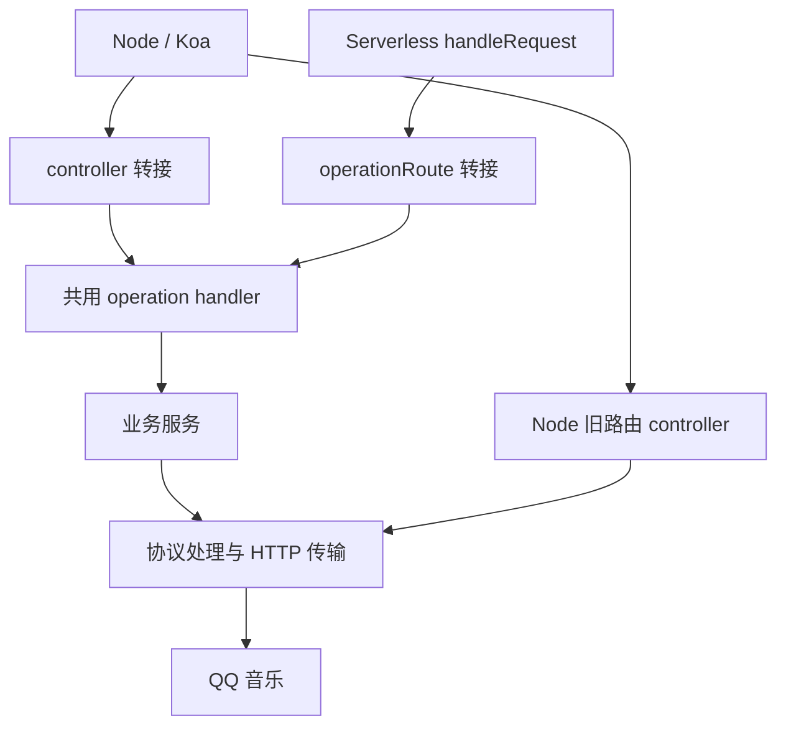

# 架构说明

这份文档帮助你定位实现、添加路由，以及判断改动需要验证什么。接口用法见[使用文档](./docs/README.md)，实际开发步骤见[贡献指南](./CONTRIBUTING.md#怎么加一条路由)。

项目有两个请求入口：Node 使用 Koa，Serverless 使用 Web 标准的 `Request` / `Response`。大部分路由通过同一个 operation handler 调用业务服务，宿主负责解析请求、提供依赖和写回响应。

## 代码怎么分工

| 位置 | 负责什么 |
| --- | --- |
| `src/app.ts`、`src/controllers/` | 组装 Node 服务、安装中间件，把 Koa 请求转成 handler 输入 |
| `src/serverless/` | 组装 Web 请求入口，提供 fetch 传输、sealed 会话和二维码状态转接 |
| `src/routes/manifest.ts` | 记录路由名称、方法、路径、handler、密钥要求及 Explorer 分类 |
| `src/routes/operations/` | 共用 handler：读取参数、调用业务、交出响应结果 |
| `src/services/` | 登录、会话、曲库、推荐、播放和写入等业务处理 |
| `src/protocol/` | 上游请求封装、响应校验、业务码登记、错误分类、播放提示规则，以及 HTTP 传输接口、超时和限流 |
| `src/transport/` | 按协议层定义的传输接口提供 fetch 实现，以及两种 HTTP 客户端共用的 Cookie jar 和转址规则 |
| `src/config/apiExplorer.ts`、`public/explorer/` | Explorer 元数据及调试页面 |
| `tests/`、`scripts/compat/` | 离线案例、接口与产物契约检查、版本行为比对 |

handler 依赖 `OperationRequest`，不用知道 Koa `Context` 或 Web `Request` 的细节。结果统一为 `{ status, headers, body }`，两种转接器分别写入 `ctx` 或生成 `Response`。业务解析和上游调用放在服务中，便于用同一份模拟响应测试。

HTTP 实现目前有三条路径：共用 musicu 客户端使用 `src/protocol/http.ts` 定义的传输接口，fetch 实现在 `src/transport/`；认证服务使用注入的 `AuthHttpClient`；旧曲库服务通过 `src/services/httpTransport.ts` 的注册槽取得传输。后两者在 Node 注入 axios 实现，在 Serverless 注入 fetch 实现。它们的超时、重试和重定向规则需要分别检查，不能把共用传输的规则当成全部接口的规则。

## 请求怎么走



### Node

`src/app.ts` 在启动时选择旧曲库传输和会话持久化方式，安装正文解析、配置 Cookie、Explorer、静态资源、请求日志、CORS 和响应耗时中间件，然后挂载路由和 `allowedMethods()`。

`src/routes/router.ts` 按 manifest 的方法与路径注册 Koa 路由。`src/controllers/index.ts` 为共用路由生成 `operationController(handler)`，外层加 `withControllerLogging`。转接器读取参数、会话 token 和正文，`service()` 提供 Node 登录服务单例，handler 返回后再写回状态、响应头和正文。

少数路由需要 Node 专用转接：`qrCheck` 在登录成功时设置 Cookie，`logout` 清除 Cookie，`getMusicPlay` 补上匿名播放所需的 Node 配置。这些转接在 `nodeAdapters` 中指定。标为 `nodeOnly` 的旧路由则从 `nodeOnlyControllers` 取得原 controller。

加载包根模块会启动监听，测试环境除外。根模块的 `server`、`configureAuthSessionRepository` 和默认 Koa 应用导出供嵌入方使用。Node 的 `stored` 会话默认存在进程内，可配置加密持久化；相关行为是嵌入契约的一部分，见[相容政策](./docs/compatibility.md)。

### Serverless

入口是 `src/serverless/index.ts` 的 `handleRequest(request, env, options)`：

1. `/login/channels` 提前处理，未配置会话密钥也能查询能力。
2. 按 manifest 生成的 Serverless 路径表匹配请求；没有对应路径时返回 `501`。
3. 路由带 `needsSecret` 且没有 `QQ_SESSION_SECRET` 时返回 `501`。
4. 为旧曲库注册 fetch 传输，并准备按需创建的认证服务。同一次请求内复用这个服务，凭证、Cookie jar 和二维码状态不作为跨请求共享的服务保存。
5. `operationRoute(handler)` 把上下文转成 `OperationRequest`，执行 handler，再把结果转成 JSON `Response`。未处理的异常交给入口的 `failureResponse`。

Serverless 使用 `sealed` 会话，凭证加密封装在 token 中；二维码状态由封存的 `unikey` 在后续请求中重建。部署配置通过 `env` 传入，中继能力通过 `options.qqRelay` 注入。入口没有 Koa 的通用 CORS 或 OPTIONS 处理，跨来源访问由宿主负责。

### 共用 handler 仍需保留的宿主差异

| 项目 | Node | Serverless |
| --- | --- | --- |
| HTTP 方法 | Koa 按 manifest 的 GET / POST 注册 | 路径匹配器不区分方法，写入 handler 自行检查并返回 `405` |
| `query(name)` | 同名参数的第一个值 | 同名参数的第一个值 |
| `queryRaw(name)` | 重复参数可返回数组 | 返回第一个值 |
| 路径格式 | 使用 manifest 的 `path` | 优先使用 `serverlessPath`，未设置时使用 `path` |
| Node 专用旧路由 | 通过旧 controller 处理 | 不注册，返回 `501` |

例如 `/getAlbumInfo` 在 Node 仍接受可选路径参数，在 Serverless 只匹配 `/getAlbumInfo` 并读取 query。迁移实现时，这些差异由测试保留；共用业务代码不意味着可以直接统一已有的 HTTP 行为。

## 路由清单与 Explorer

`src/routes/manifest.ts` 是路由注册的共同来源。每条记录包含：

| 字段 | 用途 |
| --- | --- |
| `name` | controller 导出名，也是 Explorer overrides 的键 |
| `method` | `GET` 或 `POST`，用于 Koa 注册和 Explorer 展示 |
| `path` | Node / Koa 路径 |
| `handler` | 共用路由执行的 `OperationHandler` |
| `serverlessPath` | 可选，两边路径格式不同时使用 |
| `needsSecret` | 可选，Serverless 缺密钥时提前返回 `501`；不负责验证登录 |
| `category` | Explorer 分类 |
| `nodeOnly` | Node 旧路由标记，这类记录不带共用 handler |

Koa 路由表、controller 导出、Serverless 路径表、需要密钥的路径集合和 `apiExplorerBaseRoutes` 都从这份清单生成。清单顺序也决定 Explorer 的展示顺序。Serverless 的 `/login/channels` 使用专门的提前处理分支。

Explorer 的路由列表跟随 manifest，参数、默认值、正文示例和说明仍在 `src/config/apiExplorer.ts` 的 `apiExplorerOverrides` 中维护。能力声明则在 `src/services/runtimeCapabilities.ts` 中维护，不会因为增加 manifest 记录就自动打开。

`tests/routes.manifest.test.ts` 检查名称、Koa 方法加路径和 Serverless 路径是否重复。Serverless 不区分请求方法，因此不能靠给同一路径设置不同方法来区分两个 handler。

## 错误在哪一层处理

**新接口的业务错误**由 `src/protocol/errors.ts` 的 `QqApiError` 和 `toNewRouteErrorResponse` 转成结构化结果。`NewRouteResult` 与 `OperationResult` 形状相同，服务可以直接返回给 handler。响应包含 `code`、`kind`、`errorKey`、固定说明和 `retryable`，取得上游数字码时才提供 `upstreamCode` 等可选字段。

业务码按操作和响应层级登记在 `src/protocol/businessCodes.ts`，不能把一个接口中看到的数字含义直接用于所有接口。只有已确认的凭证拒绝才按对应规则返回 `401`；普通上游拒绝、网络或格式问题通常是 `502`。新接口的无数据情况按各自契约处理，不用 `404` 表示空列表。

**保留的旧接口**沿用原有正文。有些以 HTTP `200` 加非零业务码表示拒绝；未转换的异常在 Node 由 `withControllerLogging`、Serverless 由 `failureResponse` 处理。已识别的凭证或参数错误使用相应状态，网关与凭证码冲突返回 `502`，其余兜底使用安全的 `{ error }` 模板。换成共用 handler 时，不会因此自动改为新错误格式。

**扫码检查**还使用 `800` 至 `803` 的业务状态。自然过期和登录失败的诊断字段不同，不能当作普通 HTTP 错误统一改写。具体状态、错误键和客户端处理方式见[错误对照表](./docs/errors.md)。

通用转接器不再加一层 catch 来重新分类所有错误。已知业务错误可以在 handler 或服务边界转换；仍抛出的异常交给对应宿主兜底。对外响应和日志不包含原始异常、上游正文、凭证或完整播放链接。

## Serverless 打包边界

`./serverless` 和 `./mqtt` 的整个运行时依赖闭包必须没有 npm 运行时依赖和 `node:*`。manifest、operation handler 以及它们间接引入的服务都在检查范围内，不能只检查入口文件。

- 不从共用模块引入 `src/app.ts`、Koa、axios、`ws` 或 `qrLogin.node`。Node 的实现由宿主注入，共用代码依赖中立接口。
- 纯类型依赖用 `import type` 表达。检查器按编译后保留的运行时 import / require 递归分析依赖，已擦除的类型引用不算运行时依赖。
- 不通过 bundler external、alias 或 dynamic import 绕开检查；这些做法不能让运行时真正获得缺失的模块。
- 新的 Serverless 配置通过 `ServerlessEnv` 与 `env` 参数传入。现有闭包中受宿主编译期替换的 `process.env` 名称只有 `NODE_ENV`、`JEST_WORKER_ID`、`LOG_LEVEL`，新增全局环境变量读取需要同步评估宿主。

`tests/serverless.closure-contracts.test.ts` 分别检查两个入口及其间接依赖，也检查上述环境变量范围。现有宿主契约还要求保留闭包中的 Buffer 调用引用；部分字节处理有 Web API 兜底，不能因此自行删掉这项集成约束。涉及字节实现或环境变量时，需要同时跑产物契约和下游检查。

`npm run build:js` 生成 CommonJS、ESM、类型声明和运行资源。`tests/package.artifact.test.ts` 验证实际打包后的入口和嵌入行为；`npm pack` 本身不会重新构建。

## 行为比对工具

修改内部结构时，用 `scripts/compat/check.js` 比较已发布包和当前工作树的编译产物。在 PowerShell 中运行：

```powershell
npm run build:js
npm run compat:check -- --baseline 3.3.3
```

明确指定 `--baseline` 可以固定比较对象。不指定时，工具会向 npm 查询最新版本；首次使用某个基准时会下载包，保存在被 Git 忽略的 `.compat/` 中。测试请求使用模拟上游，不访问真实 QQ 服务，也不使用真实账号。

工具从两份产物的 Explorer 元数据取接口并集，生成空参数、示例参数、重复参数、带会话与匿名、业务拒绝和上游 HTTP 失败等案例。两个版本在各自子进程里运行，固定时间与随机值，再比较 Node 与 Serverless 的状态、关键响应头、正文和发送给上游的请求。输出分别统计相同、已登记差异和未预期差异；出现未预期差异时退出码为非零。

需要缩小排查范围时，例如只比较专辑接口：

```powershell
npm run compat:check -- --baseline 3.3.3 --only /getAlbumInfo
```

经确认的行为变化记录在 `scripts/compat/approved.json`，条目可限定 runtime 和 baseline。当前判断按路径匹配放行，条目里的 `since`、`reason` 用来说明背景，并不会自动校验差异内容；新增登记必须人工审查，不能把未知失败直接放进清单来消除报错。

比对工具跳过 `/login/qr/` 扫码流程，并且模拟上游只提供有限的响应形状。未预期差异为零，表示这些离线案例与基准一致，不能据此证明扫码、实时授权、分页全量或云端部署已经验收。完整验证命令与新增路由的测试要求见[贡献指南](./CONTRIBUTING.md#测试与验证)。
